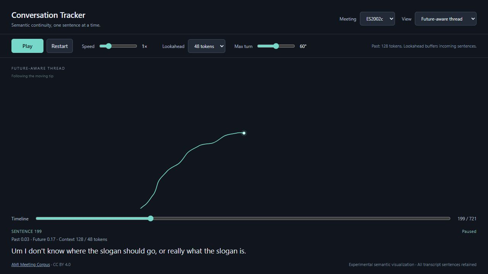

# Conversation Tracker

A local desktop prototype: real AMI meeting transcripts become a growing, curved semantic thread. The default **Future-aware thread** uses token-budgeted passage context behind and ahead of each sentence. **Original causal thread** preserves Step 2 for comparison, and **PCA comparison** preserves the absolute embedding plot with sentence hover.

**Continue in Codex cloud:** see [CLOUD_HANDOFF.md](CLOUD_HANDOFF.md) for current project state, setup instructions, network requirements, and a starter prompt. Run `bash scripts/setup-cloud.sh` in the prepared Linux environment. A complete baseline snapshot is committed under [sample-output/](sample-output/), including the offline viewer, audit records, arrays, and previews. Normal regeneration writes to ignored `output/`.



## Run

Prerequisites: Python 3.12 and [uv](https://docs.astral.sh/uv/getting-started/installation/). Both are installed on the original development machine. From this directory:

```powershell
uv run --python 3.12 python conversation_tracker.py
```

This command installs the locked dependencies into `.venv`, downloads the AMI annotation archive and MiniLM model on the first run, processes three meetings and their context passages, and opens `output/conversation_tracker.html` in your browser. Passage embedding can take several minutes on CPU. The first run needs internet access and sufficient space for CPU PyTorch and model dependencies; no GPU, API key, or account is required. Computation stays on your machine.

To generate without opening a browser:

```powershell
uv run --python 3.12 python conversation_tracker.py --no-open
```

The generated HTML includes Plotly, browser code, and all three meetings' text, embeddings, and coordinates, so it can be reopened offline. Later runs reuse `.cache/ami/` and the standard Hugging Face model cache, but recompute embeddings and PCA. No server or frontend build is needed.

To change the generated past budget or default future budget:

```powershell
uv run --python 3.12 python conversation_tracker.py --past-tokens 128 --future-tokens 48
```

The browser offers 24, 48, and 96 future tokens plus any custom default supplied above. Passage embeddings are prepared in Python; the browser switches between these prepared profiles without model inference or network access.

## Playback

- **Play / Pause:** freeze and resume the current fractional segment. Playback starts automatically; hiding the browser tab pauses it. At completion, **Replay** starts over.
- **Restart:** return to sentence 1 and play. Each subsequent sentence traces its incoming curve over one second at 1×.
- **Speed:** 0.25×–4×, adjustable without changing the playback position.
- **Timeline:** scrub to any point, including partial segments. Scrubbing pauses and immediately centers the tip. The panel shows the complete currently traced sentence; long text can scroll.
- **Lookahead:** 24/48/96 future model tokens (default 48), available in future-aware mode. Changing it rebuilds from sentence 1 and pauses. Past context defaults to 128 tokens. The panel shows the separate past/future cosine alignments and actual token counts.
- **Context K:** 1–30 preceding sentences, default 5, available only in the original causal mode. **Max turn:** 0°–120°, default 60°. Either change rebuilds the thread from sentence 1 and pauses. Existing geometry stays fixed during normal playback.
- **Meeting:** starts the chosen meeting from the beginning, retaining speed and parameter settings. **View:** switches between animated thread and original PCA, pausing and preserving playback position. Playback controls are disabled in PCA view.

The thread uses a constant scale of 36 pixels per unit, with a smooth camera following the tip; older sections can leave the viewport. Completed curves stay fixed in world space. PCA comparison retains Plotly's pan, zoom, reset, and complete-sentence hover; its green diamond marks the start and orange square the end.

## Token context and delayed playback (Step 3)

Use MiniLM's actual fast tokenizer to assemble preceding utterances backward toward 128 tokens and subsequent utterances forward toward the selected budget. Keep the selected speech in original chronological order and exclude the current sentence. Budgets include the model's special tokens. When necessary, trim the **farthest** utterance at a token boundary, then retokenize and verify the exact substring. At conversation boundaries, use the available speech; no padding, wrapping, or fabricated dialogue is added. Short acknowledgments remain in both the visualization and context.

Each assembled context is embedded as a passage with the same MiniLM model; sentence embeddings remain individual. The pipeline checks the exact token counts of **every** sentence and passage against `model.max_seq_length` (256 for this model), raising an explicit error before embedding any overlength input. Nothing is silently truncated.

Keep the two measurements separate: `A_past = cosine(sentence, past passage)` and `A_future = cosine(sentence, future passage)`. High/high suggests continuation; low/high suggests a new direction with forward support; high/low can indicate a closing thought; low/low can indicate an isolated deviation. These interpretations are heuristic, not classification labels.

The turning rule is deliberately simple and documented:

```text
departure = clip(1 - A_past, 0, 1)
support = 0.25 + 0.75 * clip(A_future, 0, 1)
raw_turn_strength = departure * support
turn_strength[i] = 0.5 * raw_turn_strength[i] + 0.5 * turn_strength[i-1]
```

Past alignment controls departure; future alignment modulates how much of that departure is sustained. The two scores are never averaged. The one-sided smoothing carries a supported turn over successive segments without moving older ones. Missing past context gives no departure; missing future context at EOF falls back to past-only strength (`support = 1`). PCA displacement still chooses each turn's sign, and constant endpoint length and Bézier rendering are unchanged. This rule is an experimental choice, not an accuracy-calibrated model.

The viewer simulates incoming speech at **one sentence per second at 1×**, independent of recorded timestamps. A segment waits until the final utterance required by its future token window has arrived, then takes one second to trace. During the wait the status says **Buffering** and shows received sentence counts. Speed scales both arrivals and drawing; Pause freezes both clocks. Larger token budgets can increase the initial delay and the delay at later short-sentence runs. Scrubbing jumps to a consistent, already-buffered playback state. Restart/replay repeat the same release schedule deterministically. At EOF, release the remaining segments with whatever future context exists. All contexts are precomputed offline; this is a streaming simulation, not live speech capture.

## Relative trajectory experiment

In **Original causal thread**, for sentence `i`, form `c_i = normalize(sum(0.8^(k-1) * z_(i-k)))`, using at most K preceding normalized embeddings. Alignment is cosine similarity `A_i`; divergence is `D_i = clip(1-A_i, 0, 1)`. Future sentences are not included in this original mode.

The initial position is `(0,0)` and heading is `(1,0)`. Subtract consecutive coordinates from the same per-meeting PCA fit to get projected embedding differences: the shared PCA centering cancels. Do not apply a centered PCA transform directly to the differences. The heading/difference cross-product sign chooses left or right; divergence scales the turn up to the selected maximum. Each endpoint advances exactly one unit along the updated heading. Zero/ambiguous projected directions and unavailable context continue straight. The first sentence has no preceding context.

Cubic Bézier control points sit one-third unit along each endpoint heading. Adjacent curves share tangent direction and magnitude. A 32-sample arc-length lookup and de Casteljau subdivision reveal the active curve and position its tip together. The camera uses frame-rate-independent exponential smoothing with a 0.2-second time constant. Geometry and playback calculations live in browser/Node-compatible modules under `web/`, inlined at generation time.

This is an **experimental semantic visualization, not a validated topic-change detector**. Backchannels such as “okay” and “yeah” remain in the thread and can cause bends within a single human-interpreted topic. PCA direction, initial heading, context size, and maximum turn all influence the shape; the complete meeting's PCA basis is fitted offline.

### Three real-data examples

At max turn=60°, scrub to the beginning of each range, then press Play. Compare **Future-aware thread** (128 past / 48 future tokens) with **Original causal thread** (K=5). Switching views preserves the sentence position and pauses. Sentence numbers are one-based; all intervening transcript sentences remain intact.

| Meeting and sentence range | What to inspect |
| --- | --- |
| ES2002a, 205–218 | Continuity: pricing, converting €25 to pounds, and what that price buys. Follow the related discussion while noting bends from short acknowledgments. |
| ES2002b, 561–586 | Gradual transition: infrared transmission develops into the implications of holding a voice-controlled remote and obstructing line of sight. Read the unfolding sentences alongside the accumulated heading changes. |
| ES2002c, 193–203 | Abrupt transition: voice control and confirmation feedback give way at sentence 199 to slogan placement, then corporate colours. Compare the turn around sentence 199 with the surrounding curves. |

These are observations from the recorded dialogue, not labeled ground truth or claims that every semantic change produces a particular curve.

The default Step 3 run reduces several previously inspected false spikes. These are individual **heading changes**, including smoothing, not accuracy measurements:

| Sentence | Original causal | Future-aware |
| --- | ---: | ---: |
| ES2002a 216, pricing continuation | 60.0° | 14.6° |
| ES2002b 273, expanding “RSI” | 57.7° | 15.0° |
| ES2002b 483, acknowledgment | 56.3° | 18.7° |
| ES2002c 199, actual slogan shift | 57.5° | 19.4° |

The genuine shift is also softened. This shows reduced over-turning, not validated separation of topic changes from continuations; further calibration would require independent labels.

## Source and processing

Credit: **AMI Project / AMI Meeting Corpus**, [manual annotations v1.6.2](https://groups.inf.ed.ac.uk/ami/download/), released under [Creative Commons Attribution 4.0 International](https://creativecommons.org/licenses/by/4.0/). The official [annotation ZIP](https://groups.inf.ed.ac.uk/ami/AMICorpusAnnotations/ami_public_manual_1.6.2.zip) is about 22 MB and contains the complete annotation release; this prototype uses only `ES2002a`, `ES2002b`, and `ES2002c`. These are transcripts of recorded, scenario-based design meetings, not unrelated example sentences.

Speaker word XML is resolved through the original transcription segments. Within each segment, annotated `.`, `?`, and `!` end sentences; trailing fragments are retained because spoken dialogue is often incomplete. Original words, capitalization, repetitions, and punctuation are retained; whitespace is reconstructed around punctuation. Nonverbal annotations such as laughter and breaths are omitted. No sentences are paraphrased or fabricated.

Sentences are merged by start timestamp, with source speaker ID and token position breaking ties deterministically. Overlapping speech is ordered by sentence onset; simultaneous speech has no unique linear order. Speaker IDs are retained solely as provenance in the exported records.

[`sentence-transformers/all-MiniLM-L6-v2`](https://huggingface.co/sentence-transformers/all-MiniLM-L6-v2) (Apache 2.0) embeds sentence and passage text into normalized 384-dimensional vectors on CPU. Inputs are checked before encoding to prevent its normal 256-token truncation. Deterministic, full-SVD PCA projects each meeting separately to two dimensions. PCA loses information, and directions/positions are not directly comparable between meetings. Lines always connect consecutive sentences, never nearest neighbors.

## Generated files

- `output/conversation_tracker.html`: self-contained animated viewer and PCA comparison.
- `output/ES2002*.sentences.json`: ordered records with one-based index, text, timestamps, meeting, source speaker, and token position.
- `output/ES2002*.npz`: NumPy arrays `embeddings` (N × 384) and `coordinates` (N × 2), in the same row order as the JSON.
- `output/ES2002*.contexts.json`: exact embedded context passages, token counts, source sentence ranges (zero-based), separate alignment scores, and final required future sentence indices for each prepared budget.
- `output/SOURCE.md` and `output/AMI-LICENCE.txt`: attribution, processing notes, and the license copied from the official archive. Preserve these alongside shared data exports.

## Checks

```powershell
uv run --python 3.12 python -m unittest discover -s tests -v
node --test tests/thread_math.test.js
```

Python tests cover transcript reconstruction, ordering/overlap, token-window boundaries and budgets, overlength rejection, PCA output, and safe offline HTML bundling. Node tests cover causal and future-aware turning, fixed prefixes, Bézier continuity, camera smoothing, and buffered playback/replay. Node 22 is installed on the original development machine; it is needed only for these tests, not to run the application. Exercise the complete real-data pipeline with the launch command above.

Steps 1–3 only: no Android application, speech recognition, speaker identification, LLMs, or rule-based filler filtering.
